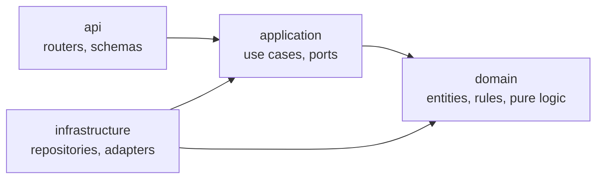
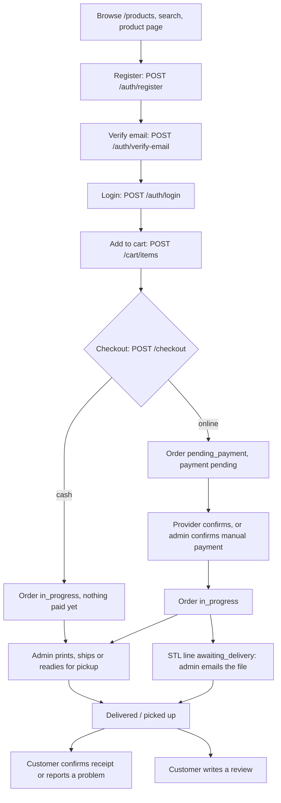
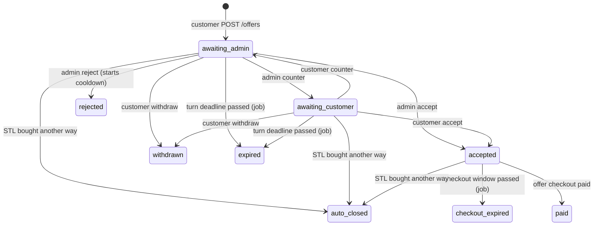
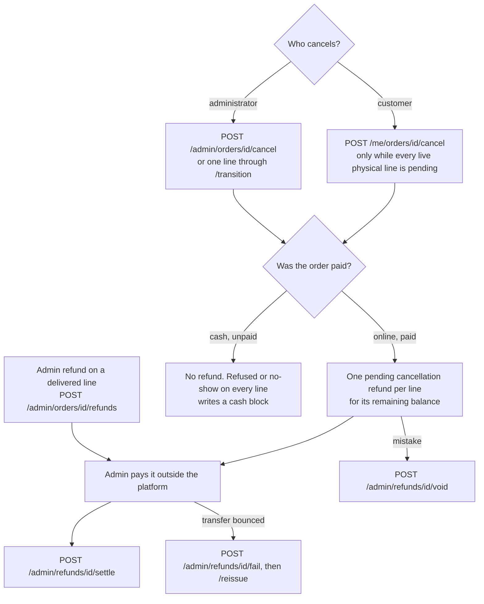
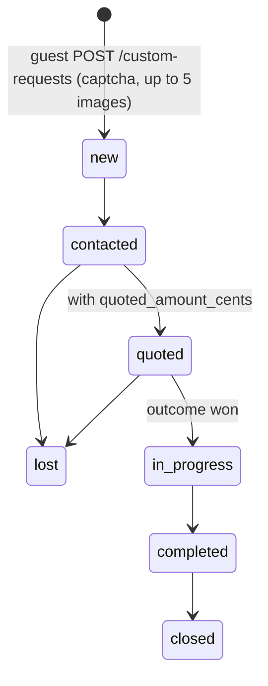
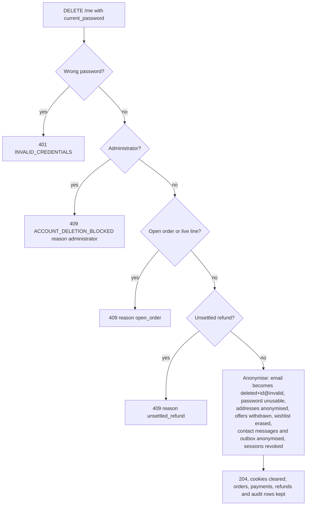
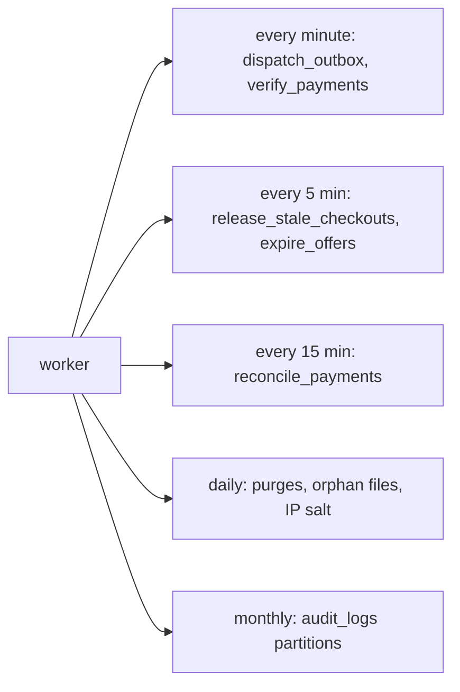

# 00 — Overview

Read this first. It explains what the system does, how the code is laid out, how the main flows
run end to end, and how to set up a local stack to test by hand.

## 1. What Bekaa3D is

Bekaa3D is a single-shop online store for a 3D-printing workshop in Lebanon. It sells two kinds
of product:

- **Physical products**: printed objects, made on demand (there is no stock), collected at the
  workshop or delivered by a courier.
- **STL products**: 3D model files. The platform never stores them. After payment the
  administrator emails the files from their own drive and marks the line delivered (ADR-019).

Customers can also **make an offer** on an STL, ask for a custom print (**Bring Your Idea**),
write **reviews**, keep a **wishlist**, and send a **contact message**. One administrator role
runs the shop from `/api/v1/admin/*`.

The back end is a FastAPI application on PostgreSQL 16 and Redis, with an `arq` background
worker. There is no front end in this repository; you test the API directly.

### The main business rules, in plain language

| Area | Rule | SRS |
| --- | --- | --- |
| Money | Prices are USD, stored as integer cents with a currency code. The server recomputes every total; a client never sends an amount on checkout. No tax, no shipping fee: the courier charges delivery directly. | BR-031, BR-050, BR-051, BR-059, BR-146 |
| Products | A physical product has a purchase mode (`online_only`, `whatsapp_only`, `both`) and accepted payment methods (online, cash, or both). WhatsApp-only products cannot go in the cart. A product may be marked unavailable: it stays listed but cannot be bought. | BR-001, BR-003, BR-009, BR-019 |
| Cart | One cart per customer. At most one line per product. An STL line always has quantity 1. A physical line is capped by the product's maximum per line. You cannot add an STL you already own. | BR-020 to BR-026 |
| Accounts | Register with email and password. You must verify your email before any write (cart, checkout, address, review…). Never-verified accounts are purged. | BR-120 to BR-122 |
| Checkout | Verified accounts only. Idempotent through the `Idempotency-Key` header. The customer picks online or cash. Cash only when every line is physical and every product accepts cash. | BR-030, BR-041, BR-140, BR-141 |
| Payment | A provider callback (webhook) is only a hint. An order becomes paid only when the server checks with the provider itself, or the administrator confirms by hand (the `manual` provider). The amount must match exactly. | BR-053 to BR-055 |
| Manual payment | V1's production provider is `manual`: the shop arranges payment with the customer by WhatsApp or phone, then the administrator confirms it. | BR-052, BR-150 |
| Cash | A cash order has no payment until handover. At handover the administrator records the cash and every live line becomes delivered or picked up, in one step. A refused cash order is cancelled without refund and blocks cash for that customer and phone. | BR-142 to BR-145 |
| Order status | Never set by hand. It is recomputed from the payment and the line states in the same transaction as every change. | BR-035 |
| Fulfillment | Each order line has its own status. Physical work never starts on an unpaid online order. | BR-036, BR-148 |
| Cancellation | A customer may cancel their own order while every live physical line is still `pending`. STL lines are never self-cancellable. | BR-066 to BR-068 |
| Refunds | Every refund is a manual obligation: recorded, paid outside the platform, then settled. Refunds may be partial and per line. | BR-061 to BR-064 |
| Offers | Offers are for STL products only, one live offer per customer and product, unlimited counters, each turn has a deadline, acceptance gives a time-limited checkout at the agreed price. | BR-080 to BR-092 |
| Reviews | Any verified user may review any product, once. Ratings 1 to 5. A "verified purchase" badge comes from real order lines. The administrator may hide or restore. | BR-100 to BR-107 |
| Bring Your Idea | A guest lead form with images; never creates an order. Images are scanned, re-encoded, stored privately, and purged after a retention period. | BR-110 to BR-115 |
| Deletion | Deleting an account anonymises it; financial and delivery records stay. Blocked while an order is open or a refund unsettled. | BR-125, BR-126 |
| Audit | Every admin action, auth event, payment, STL delivery and status change writes an audit row. Business parameters are settings, not constants. | BR-132, BR-133 |
| Kill switch | `accepting_orders = false` blocks new checkouts and new offers, never payments already in flight or answers to existing offers. | BR-040 |

## 2. Architecture

### Bounded contexts

Each context owns its own tables. One context reaches another only through
`app.<context>.public` or `app.<context>.application.ports`;
`tests/unit/test_deep_architecture.py` enforces it.

| Context | Owns | Main responsibilities |
| --- | --- | --- |
| **Identity** | `users`, `sessions`, tokens, MFA, `addresses` | Registration, login, sessions, MFA, profile, address book, account deletion, admin user management |
| **Catalog** | `products`, `categories`, `materials`, `colours`, `product_images` | Storefront, search, admin catalogue, images |
| **Ordering** | `carts`, `orders`, `order_items`, history, cash blocks, problem reports | Cart, checkout, order reads, cancel, receipt, retry, offer checkout, admin release |
| **Payments** | `payments`, `webhook_events`, `refunds`, `chargebacks` | Provider adapters, webhooks, verification, reconciliation, manual confirm, refunds, chargebacks, alerts |
| **Fulfillment** | no tables of its own (writes order lines through `ordering.public`) | Admin order queue, line transitions, cash handover, admin cancel, STL delivery queue |
| **Negotiation** | `offers`, `offer_rounds` | STL offers and their expiry |
| **Engagement** | `notifications`, `wishlist_items`, `reviews`, `custom_requests`, `contact_messages` | Notifications, wishlist, reviews, Bring Your Idea, contact form |
| **Platform** | `settings`, `audit_logs`, `email_outbox`, `idempotency_records` | Settings, audit log, outbox, idempotency claims |
| **Reporting** | reads only | Business analytics and the customer data export |

### Layers

Dependencies point inward only.



- **domain**: entities, enums, invariants, pure functions (no FastAPI, no SQLAlchemy). For example
  `ordering/domain/line_transitions.py` decides which line moves are legal.
- **application**: use cases and the ports (interfaces) they need. No infrastructure imports.
- **infrastructure**: SQLAlchemy models and repositories, provider adapters, queries.
- **api**: FastAPI routers and Pydantic schemas. Thin: validate, call the use case, translate
  domain exceptions into problem responses.

### Folder map of `src/app`

| Path | What lives there |
| --- | --- |
| `main.py` | The FastAPI app: lifespan (DB engine, Redis, payment providers, captcha check), middleware, exception handlers, routers |
| `worker.py` | The arq worker entry point (`python -m app.worker`) |
| `api/` | Cross-cutting HTTP code: `errors.py` (RFC 9457 problem bodies), `cookies.py`, `captcha.py`, `middleware.py` (request id, IP-hash key refresh), `enumeration.py` (equal response time on register/resend/reset), `head.py`, `request_target.py`, `health.py`, `openapi.py` (security schemes for Swagger) |
| `api/v1/router.py` | Mounts every context's routers under `/api/v1` |
| `api/v1/admin.py` | The `/api/v1/admin` boundary: `require_admin` on every route, the admin rate limit, the catch-all that hides unknown admin paths |
| `core/` | `config.py` (settings from `.env`), `database.py`, `security.py` (CSRF, IP hashing), `rate_limit.py`, `exceptions.py` (`ApiError`), `phone.py`, `logging.py` |
| `identity/` | `api/` (auth, mfa, profile, addresses, admin_users, dependencies), `application/commands/` (one file per use case), `application/security/` (password hashing, TOTP, tokens), `domain/` (user, address, anonymisation), `infrastructure/` (repositories, account erasure) |
| `catalog/` | `api/` (storefront, search, reference_data, products, product_images), `application/commands/`, `domain/` (product, storefront rules, search), `infrastructure/` (storefront query, repositories) |
| `ordering/` | `api/` (cart, checkout, orders, cancel, receipt, payment_retry, offer_checkout, ownership, admin_release, admin_cash_blocks, idempotent replay), `application/services/`, `domain/` (cart rules, checkout rules, cash, line transitions, order status, cancellation, handover, receipt), `infrastructure/` |
| `payments/` | `api/` (webhooks, admin_payments, admin_refunds, admin_chargebacks), `application/services/`, `domain/` (payments, refunds, chargebacks, manual, release, alerts), `infrastructure/providers/` (mock, manual) |
| `fulfillment/` | `api/` (admin_orders, item_transition, stl_deliveries), `application/` (transition_line, record_cash_handover, cancel_lines, mark_stl_delivered) |
| `negotiation/` | `api/` (offers, admin_offers), `application/services/`, `domain/` (offer rules), `infrastructure/` |
| `engagement/` | `api/` (notifications, wishlist, reviews, review_admin, custom_requests, custom_request_admin, contact_messages, admin_analytics), `application/`, `domain/`, `infrastructure/` |
| `platform/` | `api/` (settings, audit_logs), `domain/settings_registry.py`, `infrastructure/` (audit writer, outbox, idempotency) |
| `reporting/` | `api/` (admin_analytics, data_export), `application/` (reports, data_export) |
| `integrations/` | Shared adapters: `captcha/` (Turnstile, fake), `email/` (console), `images/` (Pillow re-encode), `scanning/` (ClamAV, fake), `storage/` (local disk) |
| `jobs/` | One file per background job; `registry.py` lists them and their schedules |

Each context also has a `public.py`: the only module other contexts may import.

## 3. Main workflows

### 3.1 Customer journey



Along the way the customer can keep a wishlist, manage addresses, cancel while every physical
line is `pending`, read notifications, export their data and delete the account.

### 3.2 Physical order paid in cash

```mermaid
sequenceDiagram
    actor C as Customer
    participant API
    actor A as Administrator
    C->>API: POST /cart/items (physical product)
    C->>API: POST /checkout {payment_method: cash, fulfillment_method: delivery, address_id, accept_cash_terms}
    API-->>C: 201, order in_progress, payment null, payment_due true
    Note over API: no payment row, no hold; email order_cash_placed
    A->>API: POST /admin/orders/{id}/items/{item}/transition in_production
    A->>API: ... ready_to_ship, then shipped
    Note over API: emails order_ready, order_shipped (in_production is silent)
    A->>API: POST /admin/orders/{id}/cash-handover {amount_cents = live total}
    API-->>A: 200, lines delivered, one cash payment paid, order completed
    C->>API: POST /me/orders/{id}/confirm-receipt (optional)
```

Pickup is the same with `ready_for_pickup` instead of `ready_to_ship`/`shipped`, and needs the
`pickup_address` setting. If the customer refuses: the administrator cancels the lines with
`cancel_reason: refused` (or `no_show` for pickup). No refund is created (nothing was paid), and
a **cash block** is written for the customer and the phone.

### 3.3 STL order with manual payment

Needs `PAYMENT_PROVIDER=manual` in `.env` (section 4.4).

```mermaid
sequenceDiagram
    actor C as Customer
    participant API
    actor A as Administrator
    C->>API: POST /cart/items {product_id: STL, quantity: 1}
    C->>API: POST /checkout {payment_method: online, contact_phone, accept_terms, accept_digital_final_sale}
    API-->>C: 201, order pending_payment, payment pending, next_step await_admin_contact
    Note over API: notification order.awaiting_payment; admin alert manual_payment_due
    A->>API: GET /admin/payments?awaiting_confirmation=true
    Note over A,C: Admin contacts the customer by WhatsApp or phone; customer pays
    A->>API: POST /admin/payments/{id}/confirm {verified_amount_cents, verified_currency, reason}
    API-->>A: 200, payment paid, STL line awaiting_delivery
    A->>API: GET /admin/stl-deliveries
    Note over A: Admin emails the files from their own drive
    A->>API: POST /admin/orders/{id}/items/{item}/transition {target_status: delivered}
    API-->>A: 200, order completed; customer gets order_stl_delivered email
```

If the customer never pays, `release_stale_checkouts` releases the order at
`hold_expires_at` (7 days by default, `manual_payment_hold_period`), or the administrator
releases it earlier with `POST /admin/orders/{id}/release`.

With the default `PAYMENT_PROVIDER=mock`, the same checkout returns a `redirect_url` and you pay
the attempt with `scripts/mock_pay.py` (section 4.4).

### 3.4 Offers



Each turn has a deadline (`offer_response_window`, 48 h). Acceptance freezes the price and opens
a checkout window (`offer_checkout_window`, 24 h) at `POST /me/offers/{id}/checkout`.

### 3.5 Cancellation and refunds



A refund that would empty an unfinished physical line is refused with
`REFUND_REQUIRES_CANCELLATION`: cancel the line instead. A line covered in full by refunds
becomes `refunded`; the order becomes `partially_refunded` or `refunded`.

### 3.6 Bring Your Idea



Every move is `POST /admin/custom-requests/{id}/transition`. Reference images are downloadable by
the administrator only, and purged after `custom_request_attachment_retention` (90 days).

### 3.7 Account deletion



### 3.8 Background worker jobs

All schedules are UTC, in `src/app/jobs/registry.py`. "Startup" means it also runs when the
worker starts.

| Job | When | What it does |
| --- | --- | --- |
| `dispatch_outbox` | every minute, startup | Sends due `email_outbox` rows; retries with backoff, `failed` after 5 attempts; redacts the payload once sent |
| `verify_payments` | every minute, startup | Verifies up to 50 stored webhook events whose verification did not finish |
| `reconcile_payments` | minutes 0, 15, 30, 45 (second 30), startup | Asks the provider about live attempts older than 5 minutes; raises alerts (`stuck`, …). Skips `manual` |
| `release_stale_checkouts` | every 5 minutes from :02 (second 45), startup | Releases unpaid online orders past their hold, only on the provider's `failed`/`expired`; for `manual`, at the deadline |
| `expire_offers` | every 5 minutes (second 30), startup | Expires offers past their turn deadline or checkout window; sends the "expiring soon" reminder |
| `purge_unverified_accounts` | daily 03:17 | Deletes accounts never verified past the retention setting |
| `purge_expired_security_records` | daily 03:29 | Deletes expired tokens and ended sessions past retention |
| `purge_expired_attachments` | daily 03:35 | Deletes expired Bring Your Idea images (file and row) |
| `reap_orphan_files` | daily 03:41 | Deletes stored files no row references, after a grace period |
| `purge_expired_idempotency_records` | daily 03:53 | Deletes expired idempotency claims |
| `rotate_ip_salt` | daily 00:23, startup | Rotates the IP-hash salt once per UTC month |
| `ensure_partitions` | the 1st of each month 00:07, startup | Creates monthly partitions of `audit_logs` ahead of time |



To watch them: `docker compose logs -f worker`.

## 4. Running locally

### 4.1 Start the stack

From the repository root (PowerShell or Git Bash):

```sh
cp .env.example .env            # first time only; replace every placeholder secret
docker compose up -d --build    # postgres, redis, clamav, api, worker
docker compose exec api alembic upgrade head
curl http://localhost:8000/health/ready
```

- Host ports: API `8000`, Postgres `5442` (not 5432), Redis `6379`, ClamAV `3310`.
- `.env` must keep `ENVIRONMENT=development` (otherwise cookies become `Secure` and are dropped over
  `http`), `CAPTCHA_PROVIDER=fake` and `PAYMENT_PROVIDER=mock` or `manual`.
- ClamAV downloads its virus definitions on first start (a few minutes). Until it is healthy,
  product image upload and Bring Your Idea attachments answer `503`.
- Run `alembic upgrade head` again after every `git pull`.

### 4.2 Seed data and the credentials file

The seed creates an administrator (MFA enrolled), a verified customer and a small catalogue. In
PowerShell, which has no `<`:

```powershell
Get-Content scripts/dev_seed.py | docker compose run --rm -T -e PYTHONPATH=src api python - > C:\Users\user\bekaa3d-seed-credentials.txt
```

In Git Bash: `docker compose run --rm -T -e PYTHONPATH=src api python - < scripts/dev_seed.py > /c/Users/user/bekaa3d-seed-credentials.txt`.

- **The seed credentials file is `C:\Users\user\bekaa3d-seed-credentials.txt`**, outside the
  repository. Never copy it into the repo, a commit, an issue or a chat.
- The script prints the credentials **once**, when it creates the accounts. On a later run they
  already exist and it prints none. To get new ones (new passwords, TOTP secret and recovery
  codes; sessions ended) add `--rotate-credentials` after the dash: `python - --rotate-credentials`.
- Add `--whatsapp-number +96170123456` to set the `whatsapp_number` setting.

What the seed creates:

| What | Detail |
| --- | --- |
| Administrator | `seed-admin@example.com`, verified, MFA (TOTP) enabled |
| Customer | `seed-customer@example.com`, verified, two unread notifications, no addresses |
| Categories | `home-decor`, `toys-figures`, `tools-gadgets`, `seasonal` (disabled) |
| Materials / colours | PLA, PETG, Resin / Black, White, Red |
| Physical products | `moon-lamp` (featured), `geometric-planter`, `dragon` (two images), `cable-organizer` (online only), `name-sign` (WhatsApp only), `knight` (unavailable) |
| STL products | `dragon-stl`, `phone-stand-stl` (featured), `low-poly-vase-stl` (unavailable) |
| Hidden from the storefront | `prototype-gear` (not visible), `holiday-ornament` (disabled category) |
| Settings | `accepting_orders = true` |

The seed does not set `pickup_address`, so pickup checkout answers `422 INVALID_FULFILLMENT`
until the administrator sets it (`PATCH /api/v1/admin/settings/pickup_address`).

A second customer helps with ownership tests (another customer's address, order or offer must
answer `404`). Register one through the API (section 4.6 explains how to read the verification
email).

### 4.3 The admin TOTP code

Add the TOTP secret from the credentials file to an authenticator app, or compute the current
code with the project's own library:

```sh
.venv/Scripts/python -c "import pyotp; print(pyotp.TOTP('<secret>').now())"
```

Each code works **once** per 30-second step: a second admin login in the same step needs the next
code or a recovery code (each recovery code also works once).

### 4.4 Payment providers for testing

`PAYMENT_PROVIDER` in `.env` picks the online provider; only one runs at a time. After changing
it, recreate the containers: `docker compose up -d --force-recreate api worker`.

- **`mock`** (the default): checkout answers a `redirect_url`. Nothing over HTTP can pay a mock
  payment; drive it with the script (Git Bash; in PowerShell pipe it with `Get-Content` as above):

  ```sh
  docker compose run --rm -T -e PYTHONPATH=src api python - <payment_id> paid --send-to http://api:8000 < scripts/mock_pay.py
  ```

  States: `paid` (add `--captured-amount-cents N` for a wrong amount, which becomes a late
  capture), `processing`, `failed`, `expired`.
- **`manual`** (production's provider): checkout answers `redirect_url: null` and
  `next_step: await_admin_contact`; the administrator confirms with
  `POST /api/v1/admin/payments/{payment_id}/confirm`. Its webhook route answers `404`.
- **`none`**: online checkout answers `503 ONLINE_PAYMENT_UNAVAILABLE`; cash still works.

### 4.5 Testing with Swagger UI

Open **http://localhost:8000/docs**. Swagger runs on the API's own origin, so the browser stores
the login cookies and sends them on every "Try it out" call. You only have to supply the CSRF
header.

**Login as the customer**

1. `POST /api/v1/auth/login` → Try it out → body
   `{"email": "seed-customer@example.com", "password": "<from the credentials file>"}` → Execute.
   Expect `200` with `SessionRead`. The browser now holds `access_token`, `refresh_token` and
   `csrf_token`.
2. Open DevTools (F12) → **Application** → **Cookies** → `http://localhost:8000` → copy the value of
   **`csrf_token`** (it is the one cookie that is not `httpOnly`).
3. Click **Authorize** at the top of Swagger → in **csrfToken (apiKey)** paste the value →
   Authorize → Close. Leave `sessionCookie` empty: the browser sends the cookie itself.
4. Every write (POST, PATCH, PUT, DELETE, and `GET /me/export`) now carries `X-CSRF-Token`.

**Login as the administrator (MFA)**

1. `POST /api/v1/auth/login` with the admin email and password. Expect **`202`** with
   `{"challenge_id": "...", "expires_in_seconds": 300}`. No cookies are set yet.
2. `POST /api/v1/auth/mfa/verify` with `{"challenge_id": "<from step 1>", "code": "<6-digit TOTP>"}`
   (or `"recovery_code"` instead of `"code"`, never both). Expect `204`; now the cookies are set.
   A wrong code burns the challenge: log in again.
3. Copy `csrf_token` from DevTools and paste it into **Authorize → csrfToken** as above.

**Practical notes**

- One browser holds one session. Use a normal window for the customer and a private window
  (or another browser) for the administrator, each with its own Swagger tab and CSRF value.
- A new login (or MFA verify) gives a new `csrf_token`; update Authorize after every login.
  `POST /auth/refresh` keeps the same session, so the CSRF value stays the same.
- The access token lasts 15 minutes. When calls start answering `401 AUTH_REQUIRED`, call
  `POST /api/v1/auth/refresh` (CSRF header needed), or log in again.
- Endpoints that need `Idempotency-Key` show it as a header parameter: type any 8-255 character
  value of `[A-Za-z0-9._:-]` (for example `test-checkout-0001`). Use a new key for each new
  attempt; reuse it only to test replay.
- Every error is `application/problem+json` with a stable `code`; test against the `code`, not
  `detail`. Every response carries `X-Request-ID`, also in the error body as `request_id`.
- Never add a trailing slash: `/api/v1/products/` answers `307`.
- Datetime query parameters need a full timestamp with a UTC offset, for example
  `2026-10-01T00:00:00Z`. A bare date such as `2026-10-01` is `422`. This matters most for
  **`GET /api/v1/admin/analytics/custom-requests/funnel`** (`from`, `to`), and also for the
  `created_after`/`created_before`, `placed_after`/`placed_before`, `responds_before` and
  analytics `from`/`to` filters elsewhere.
- For a `multipart/form-data` endpoint (`POST /custom-requests`, image upload) Swagger shows a
  form with file pickers.

### 4.6 Reading emails from `email_outbox`

`EMAIL_PROVIDER=console` sends nothing; it logs only the names of the payload fields. Every email
is a row in `email_outbox` (`recipient_email`, `template`, `payload`, `status`, `sent_at`). Once
the worker "sends" a row it replaces every payload value with `[redacted]`, so **stop the worker
first** when you need a token:

```sh
docker compose stop worker
docker compose exec -T postgres psql -U bekaa3d -d bekaa3d -Atc "select payload->>'verification_url' from email_outbox where recipient_email = 'you@example.com' and template = 'verification_email' order by created_at desc limit 1"
docker compose start worker
```

- Password reset: `template = 'password_reset_email'` and `payload->>'reset_url'`.
- The links look like `http://localhost:3000/verify-email#token=...`; the token is everything after
  `#token=`. Send it to `POST /auth/verify-email` or `/auth/password-reset/confirm`.
- To see every email a flow produced: `select template, status, payload from email_outbox order by created_at desc limit 10;`
- Templates in use: `verification_email`, `password_reset_email`, `order_awaiting_payment`,
  `order_cash_placed`, `order_payment_confirmed`, `order_checkout_expired`, `order_ready`,
  `order_shipped`, `order_ready_for_pickup`, `order_delivered`, `order_picked_up`,
  `order_stl_delivered`, `order_cancelled`, `order_refund_issued`, `order_refund_cancelled`,
  `offer_countered`, `offer_accepted`, `offer_rejected`, `offer_expiring_soon`,
  `admin_payment_alert`.

### 4.7 Rate limits and the Redis reset

All host requests reach the API from the Docker gateway IP, so your browser and any script share
one per-IP budget. The limits you hit first when testing:

| Limit | Budget | Redis key |
| --- | --- | --- |
| Login, per IP | 20 per hour | `ratelimit:auth:login:<ip>` |
| Login failures, per (email, IP) | attempts 1-3 free, 4-7 wait 1/2/4/8 s, 10th refused for 15 minutes (`429`, `Retry-After: 900`) | `login-throttle:<hash>:<ip>` |
| Register, resend verification, reset request | 5 per hour per IP each | `ratelimit:auth:register:*`, `…:auth:resend:*`, `…:auth:reset-request:*` |
| MFA verify | 10 per 15 minutes per IP | `ratelimit:auth:mfa:verify:*` |
| Admin router | 300 per minute per administrator | `ratelimit:admin:<user_id>` |

A successful login clears that pair's `login-throttle` counter. To clear every counter after a
heavy test session:

```sh
docker compose exec -T redis sh -c "redis-cli --scan --pattern 'ratelimit:*' | xargs -r redis-cli DEL"
docker compose exec -T redis sh -c "redis-cli --scan --pattern 'login-throttle:*' | xargs -r redis-cli DEL"
```

Never `FLUSHALL`: the same Redis holds MFA challenges and completed-MFA flags (`mfa:*`), the
mock payment states (`mock_payment:*`) and the job queue.

Password reset also has a silent 2-minute cooldown per account: inside it the request still
answers `202` but writes no email.

### 4.8 Useful database reads

```sh
docker compose exec -T postgres psql -U bekaa3d -d bekaa3d
```

- `select id, order_number, status, payment_method from orders order by placed_at desc limit 5;`
- `select id, fulfillment_status from order_items where order_id = '<id>';`
- `select action, entity_type, created_at from audit_logs order by created_at desc limit 20;`
- `select key, value from settings;`

Read only: never fix test data by hand in the database.

## 5. Error format

Every non-2xx response is RFC 9457 `application/problem+json`:

```json
{
  "type": "http://localhost:8000/problems/VALIDATION_ERROR",
  "title": "Request body failed validation",
  "status": 422,
  "detail": "One or more fields failed validation.",
  "instance": "/api/v1/cart/items",
  "code": "VALIDATION_ERROR",
  "request_id": "req_3f2a...",
  "errors": [{"loc": ["body", "quantity"], "msg": "...", "type": "..."}]
}
```

Codes common to every endpoint:

| Status | Code | When |
| --- | --- | --- |
| 400 | `MALFORMED_REQUEST` | the body is not valid JSON |
| 401 | `AUTH_REQUIRED` | no access cookie, an expired or forged one, or one from before a password reset |
| 401 | `MFA_REQUIRED` | an administrator session that has not completed MFA, on an admin route |
| 403 | `CSRF_INVALID` | a cookie-authenticated write without the right `X-CSRF-Token` |
| 403 | `EMAIL_VERIFICATION_REQUIRED` | a write by an unverified account |
| 404 | `NOT_FOUND` | unknown resource, another user's resource, or a customer on any admin path |
| 405 | `METHOD_NOT_ALLOWED` | wrong method on a real path (with `Allow`) |
| 422 | `VALIDATION_ERROR` | a field fails validation, an unknown field (`extra="forbid"`), a bad query parameter or cursor, or a control character in the path or query |
| 429 | `RATE_LIMITED` | a limit is exhausted; `Retry-After` says how long |
| 500 | `INTERNAL_ERROR` | an unexpected fault; details only in the log |
| 503 | `SERVICE_UNAVAILABLE` | PostgreSQL or Redis unreachable, or captcha/scanner outage |

The per-context files list only the codes specific to each endpoint, plus these where they need
a test.
